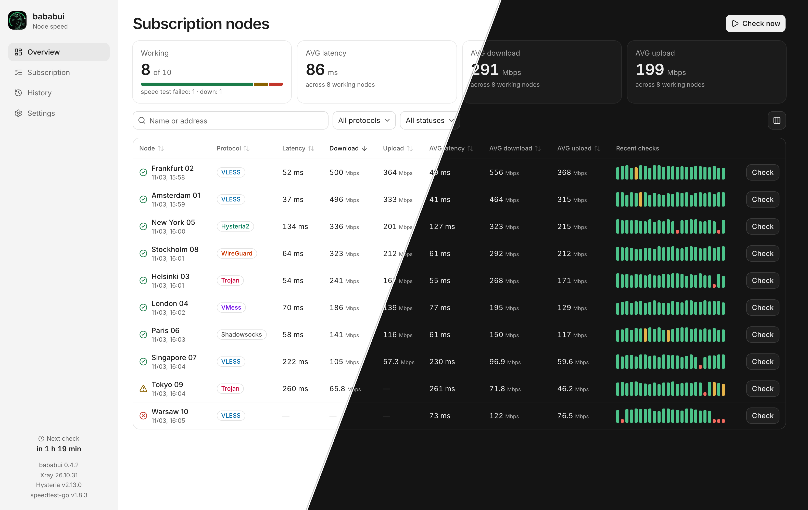
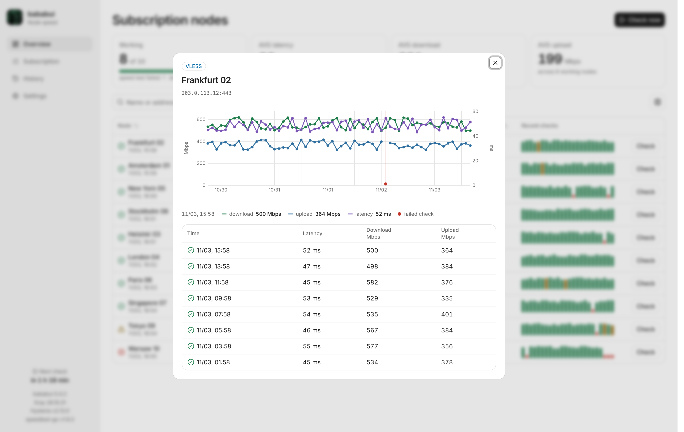
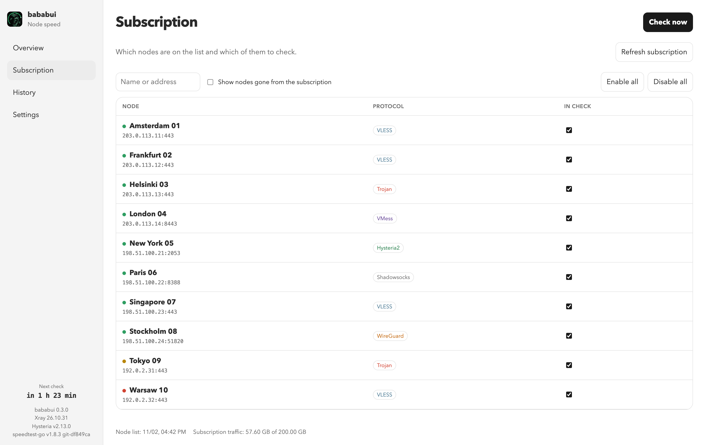
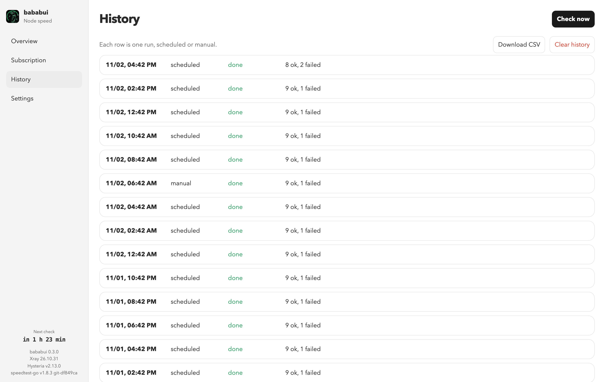

<p align="center">
  
</p>

<h1 align="center">bababui</h1>

<p align="center">
  Self-hosted speed checks for every node in your proxy subscription.
</p>

<p align="center">
  <a href="https://hub.docker.com/r/nokk3r/bababui"></a>
  <a href="https://hub.docker.com/r/nokk3r/bababui"></a>
  <a href="LICENSE"></a>
</p>



bababui loads the nodes from a subscription link, measures each one on a schedule, and keeps the results in SQLite. You manage everything from a web interface and need nothing on the host except Docker.

## Features

- **Real speed through each node:** latency, download, and upload measured by `speedtest-go` through that node.
- **Wide protocol support:** VLESS, VMess, Trojan, Shadowsocks, WireGuard, and Hysteria2.
- **Scheduled and manual checks:** every 120 minutes by default, or on demand for all nodes or just one.
- **History and charts:** per-node graphs, 48-hour sparklines, and CSV export.
- **Clear failure states:** a separate marker for a node that is alive when only the speed test failed.
- **Small footprint:** one container for `amd64` and `arm64`, with an optional password on the interface.
- **Works everywhere:** light and dark themes, phone layout, keyboard navigation, and English and Russian.

## Quick start

Start the container:

```bash
docker run -d --name bababui \
  --restart unless-stopped \
  -p 127.0.0.1:8080:8080 \
  -e WEB_PASSWORD=change-me \
  -v bababui-data:/data \
  nokk3r/bababui:latest
```

Open <http://127.0.0.1:8080> and add your subscription link in **Settings**. The first check starts about 8 seconds after a restart if the link is already saved, then follows the interval from the settings.

### Docker Compose

```bash
curl -O https://raw.githubusercontent.com/nokk3r/bababui/main/docker-compose.prod.yml
echo 'WEB_PASSWORD=change-me' > .env
docker compose -f docker-compose.prod.yml up -d
```

This file needs `WEB_PASSWORD` and pins the image to a specific version.

### Build from source

```bash
git clone https://github.com/nokk3r/bababui.git
cd bababui
cp .env.example .env
docker compose up -d --build
```

## Screenshots

| Node details | Subscription |
| --- | --- |
|  |  |

| Check history |
| --- |
|  |

The screenshots show invented nodes and addresses.

## Configuration

Set these in `.env`, or pass them to the container. `BIND_HOST` and `PORT` apply to the Compose files.

| Variable | Default | Description |
| --- | --- | --- |
| `BIND_HOST` | `127.0.0.1` | Address the interface is published on. Use `0.0.0.0` to listen on all addresses. |
| `PORT` | `8080` | Port on the host. The service always listens on 8080 inside the container. |
| `WEB_PASSWORD` | empty | Password for the interface. Empty leaves it open on the published address. `docker-compose.prod.yml` refuses to start without it. |
| `LOG_LEVEL` | `INFO` | `DEBUG`, `INFO`, `WARNING`, `ERROR`, or `CRITICAL`. `INFO` writes a line per node, and `WARNING` keeps only failures. It does not affect Xray and Hysteria logs. |

The subscription link, check interval, node selection, and results are stored in the `bababui-data` volume.

The password travels unencrypted over plain HTTP. If you open the interface beyond the local machine, put it behind a reverse proxy with HTTPS.

## How it works

For each enabled node, bababui starts a local SOCKS proxy through that node. Xray handles VLESS, VMess, Trojan, Shadowsocks, and WireGuard. Hysteria2 uses its own client because Xray does not support it.

`speedtest-go` then runs through that proxy against speedtest.net and measures HTTP latency, download, and upload. The server is picked from the node's exit address, and the transfer size follows the link speed, so the amount of traffic is not known in advance.

| Status | Meaning |
| --- | --- |
| 🟢 Green | The measurement succeeded. |
| 🟡 Yellow | The speed test failed, but traffic passes through the node. |
| 🔴 Red | No traffic passes through the node. |

Both directions are measured by default, one node at a time. History is kept for 30 days and can be exported to CSV or cleared. WireGuard runs in user space, so the container needs no privileges on the host's network interfaces.

## Languages

The interface is in English by default, with Russian available in **Settings → General** and on the sign-in page. The choice is saved in the browser.

To add a language, put a translation next to the others in `static/locales/<code>.json`, using `en.json` as the source, and add it to `LANGUAGES` in `frontend/src/lib/i18n.js`. Keys ending in `_one`, `_few`, `_many`, or `_other` are plural forms. The backend stores no text: errors are sent as markers like `[[stopped]]` and translated in the browser through the `server.` keys. CSV files are always in English.

## Development

The interface is built with Vue, Vite, and Tailwind CSS and lives in `frontend/`. Locales and icons stay in `static/` because both the backend and the build read them. Components in `frontend/src/components/ui` come from [shadcn-vue](https://www.shadcn-vue.com) and are ours to edit. Add more with `npx shadcn-vue@latest add <name>`.

Some generated components carry local changes. Running `add --overwrite` resets them, so reapply these afterwards:

- `input/Input.vue` and `select/SelectTrigger.vue`: fields are `h-9` tall.
- `select/SelectContent.vue`: the list opens below the trigger (`position="popper"`, `align="start"`).
- `select/SelectContent.vue` and `dropdown-menu/*Content.vue`: a stronger ring and shadow in the dark theme, without the undefined `cn-menu-translucent` class.
- `dialog/DialogContent.vue`: the close button label is translated.
- `sonner/Sonner.vue`: imports `vue-sonner/style.css`, without which toasts render unstyled at the bottom of the page, and `--gray2` uses `color-mix`, because the theme colors are hex values.

The CLI also edits project files on every `add`. After it runs, remove the Google Fonts import and the duplicate `@layer base` block it adds to `src/app.css`, and restore `package.json` if it unpinned `cn` or bumped other packages.

The dev server proxies `/api` to a backend running on `127.0.0.1:8080`:

```bash
cd frontend
npm ci
npm run dev
```

Then open <http://localhost:5173/static/>.

Run the backend tests with Python 3.12 or newer:

```bash
python -m unittest discover -s tests
```

## Changelog

See [CHANGELOG.md](CHANGELOG.md).

## License

[MIT](LICENSE)
